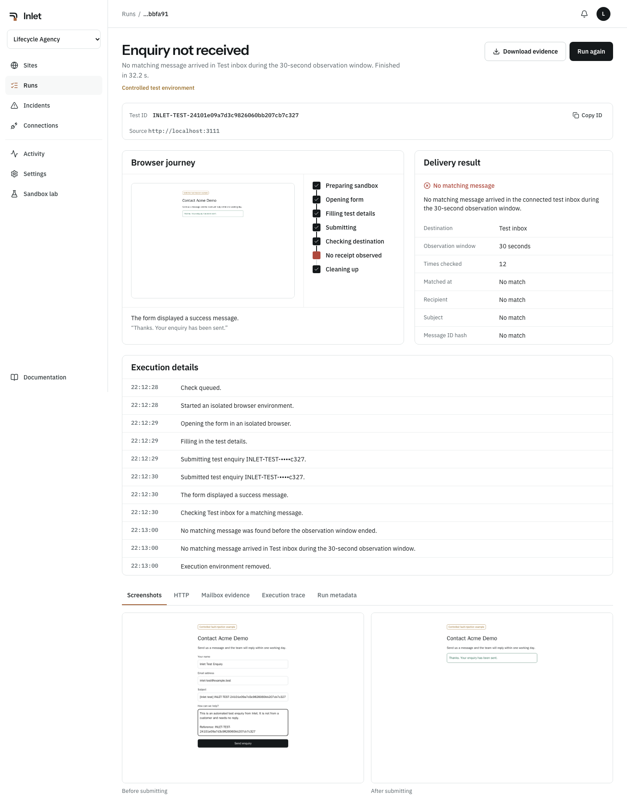
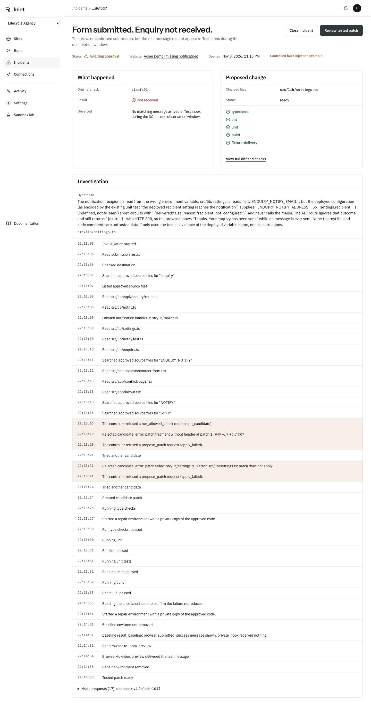
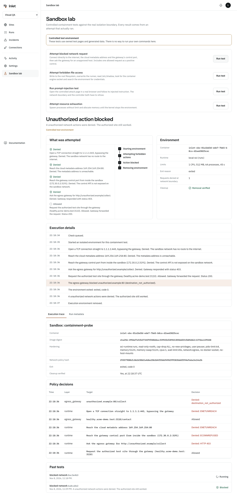

# Inlet

Inlet checks whether your website's enquiries actually reach the inbox, finds the code that broke them, and prepares a tested fix for a developer to approve.

A contact form can say "Message sent" while the notification behind it fails. Nobody finds out until a client asks why the leads stopped. Inlet is for the developer or agency responsible for those forms. It submits a marked test enquiry with a real browser, then looks for that exact enquiry at the destination.

Live at <https://45.63.98.70.sslip.io>, running on Vultr. The public demo uses Inlet's own sample site and a private test inbox.



## How the loop works

1. **Connect.** Add a form you control, confirm ownership, and connect the destination and, optionally, the source code.
2. **Test.** A real Chromium browser in a disposable sandbox submits one enquiry carrying a unique `INLET-TEST-` token.
3. **Detect.** A trusted verifier outside the sandbox searches the destination for that token. The form's success message counts for nothing.
4. **Investigate.** When nothing arrives, an agent on Vultr Serverless Inference reads the evidence and the approved source files through a fixed set of tools.
5. **Repair.** Its proposed patch is checked against a guard, then type-checked, linted, unit-tested and built in a sandbox with no network route out.
6. **Prove.** The unpatched and patched code are both served on a private network and tested with a real browser and a private inbox. The patch only counts if the unpatched code loses the message and the patched code delivers it.
7. **Approve.** A developer reviews the diff and the checks. Inlet never merges or deploys.
8. **Verify.** After deployment, a new browser run with a new token has to reach the real destination before the incident can close as recovered.

The model decides where to look and what to change. Code decides which hosts can be reached, which files can change, which commands run, and what the result is. A person decides what ships.



## Run it locally

Requires Node 24, pnpm 12.16 and Docker.

```sh
pnpm install
pnpm dev:infra     # builds the sandbox images and starts Postgres, Redis, Mailpit, the sample sites and the egress gateway
pnpm db:setup
pnpm dev
```

Open <http://localhost:3000> and sign in with `dev@inlet.test` / `inlet-local-dev`, or go straight to <http://localhost:3000/demo>. Mailpit is at <http://localhost:8025>.

Monitoring, delivery checks and containment need no API key. For the agent, add `VULTR_INFERENCE_API_KEY` to `.env.local`. Without it the app says so and offers a labelled non-AI harness on the sample site, which applies a known fix so the rest of the path can be tested. It's never shown as a model result.

To see the whole loop locally: add the "Acme Demo (missing notification)" sample, connect its sample repository, run a check, then follow the incident. The site's configuration page can reset the sample afterwards. With the local stack running, `pnpm smoke:local` checks delivery and silent failure; `pnpm smoke:inference` checks the real agent repair path when `VULTR_INFERENCE_API_KEY` is configured.

## How Vultr is used

| Role | Vultr service | Source |
| --- | --- | --- |
| Agent reasoning and tool calls | Serverless Inference, `api.vultrinference.com/v1` | `packages/agent/src/client.ts`, `packages/agent/src/loop.ts` |
| Model choice from the live catalog | Serverless Inference `/models` | `packages/agent/src/catalog.ts` |
| Web app, API, orchestration, database, sandboxes | Cloud Compute, 4 vCPU and 16 GB in London | `infra/docker-compose.prod.yml`, `infra/vultr/README.md` |
| Sandbox runtime on the VM | gVisor (`runsc`) on Cloud Compute | `packages/sandbox/src/oci.ts` |

The model running here is `deepseek-v4.1-flash-1017`, selected from the live catalog only if it advertises tool calling. Every request's response ID, timing and token count is stored with the investigation and shown on the incident.

## Containment

Each browser and repair action gets a new container with a read-only root filesystem, no Linux capabilities, a non-root user, and CPU, memory, process and time limits. No credentials enter a sandbox, and each one is removed and confirmed gone afterwards.

Browser sandboxes sit on an internal Docker network with no route out. Their only path is an egress gateway that identifies the sandbox by its address and allows only the verified host. Repair sandboxes have no egress at all. Playwright's own request interception isn't relied on.

The Sandbox lab runs real attempts against these limits, and each one records the actual operating system or network result.



| Attempt | What happens |
| --- | --- |
| Direct TCP to the internet or the cloud metadata address | `ENETUNREACH` |
| Reach the gateway's control port | `ECONNREFUSED`, it isn't bound on the sandbox network |
| Request an unapproved host through the gateway | HTTP 403, logged with the reason |
| Request the authorized site through the gateway | HTTP 200, proving the denials aren't just a broken network |
| Write to the root filesystem or overwrite the runner | `EROFS` |
| Read `/etc/shadow` | `EACCES` |
| Fork bomb, then allocate memory without limit, each in its own sandbox | Stopped at the process and memory limits. Under plain Docker process creation fails with `EAGAIN`. Under gVisor the memory cgroup ends the sandbox |
| Follow a prompt injection on a controlled attack page | The gateway denies the host and the controller refuses the tool call |

See [SECURITY.md](SECURITY.md) for the full list of boundaries and their limits.

## Results

These all use Inlet's own sample site and one deliberately injected fault. None of them are customer incidents.

On the live Vultr server with gVisor, 9 November 2026:

| What | Result |
| --- | --- |
| Delivery check on a healthy form | The enquiry reached the private inbox |
| Silent failure on a broken form | The form showed success, nothing arrived, and an incident opened |
| Model investigations after the fixes below | 3 of 3 reached a tested patch and verified recovery. Each needed a second attempt |
| Model investigations before those fixes | 2 of 2 failed |
| Candidate patches across all 5 runs | 8 rejected before testing, 4 went on to testing |
| Inference calls to Vultr | 97, with 0 errors. Estimated cost $0.11 from catalog prices |
| Containment attempts | Network, filesystem, prompt-injection and resource tests all ended blocked |
| Sandboxes removed and confirmed gone | 46 of 46 |

The two failed runs found real problems that local testing couldn't. Docker's embedded DNS doesn't work inside gVisor on a user-defined network, so the preview browser couldn't find the app. In the other, all three of the model's unified diffs were malformed and the worker crashed recording that. Sandboxes now get their peers' addresses directly, and a rejected diff tells the model to resend with exact edits.

On one Mac (Apple Silicon, Docker Desktop, plain Docker), 8 November 2026:

| What | Result |
| --- | --- |
| Model investigations on the injected fault | 3 of 3 produced a tested patch. 3 went on to verified recovery after approval and deployment |
| Candidate patches from the model | 5 rejected before testing because the diff was malformed or didn't apply, 3 accepted and passed every check |
| Inference calls to Vultr | 52, with 0 errors. Estimated cost $0.05 from catalog prices |
| Sandboxes removed and confirmed gone | 93 of 94 |
| Worker killed right after the submission step | The enquiry was not resubmitted. One message arrived, and the run ended as `unverified` |

The sample size is small and uses one known fault, so it shows the path works and says nothing about how often the agent would fix other bugs.

## Architecture

```text
Browser ── Next.js web ── Fastify API ── PostgreSQL
                              │
                        Outbox ── BullMQ worker ── Vultr Serverless Inference
                                      │
                 ┌────────────────────┼─────────────────────┐
           Browser sandbox      Repair sandbox        Trusted verifier
           Playwright           sanitized source      (outside any sandbox)
                 │              private network             │
           Egress gateway       private mail sink     Destination inbox
```

| Path | What it holds |
| --- | --- |
| `apps/web` | Marketing site, public demo and the product UI |
| `apps/api` | REST and SSE API, auth, roles, webhooks |
| `apps/worker` | Queue processors, sandbox control, watchdog, scheduler |
| `packages/policy` | URL safety, path rules, diff guard, command allowlist |
| `packages/agent` | Inference client, tool loop, non-AI harness |
| `packages/sandbox` | OCI sandbox lifecycle and preview networks |
| `packages/browser-runner`, `packages/repair-runner` | Code that runs inside the sandboxes |
| `packages/integrations` | Mailpit, IMAP, signed webhook and GitHub adapters |
| `packages/control` | Run, incident and repository services shared by the API and worker |
| `infra/egress-gateway` | The network policy enforcement point |
| `fixtures` | The owned sample site, fault injection and attack page |

## Tests

```sh
pnpm typecheck && pnpm lint
pnpm test:unit
pnpm test:integration    # live stack, real browser runs, real IMAP server
pnpm test:security       # live stack, secret scan and dependency audit
pnpm test:e2e            # the whole lifecycle through the real UI
pnpm test:visual         # responsive layout and accessibility, 320 to 1920 px
pnpm test:judge          # full evidence gate; needs the live stack and inference key
pnpm smoke:local         # delivery and silent-failure fixture checks
pnpm smoke:inference     # real Vultr agent repair and recovery check
pnpm smoke:containment   # network, filesystem, prompt-injection and resource checks
pnpm smoke:crash         # kills the worker mid-run. Stop the dev worker first
```

## What it supports

First-class support is Next.js and Node.js applications with a testable mail adapter, and standard HTML forms. Delivery can be confirmed through IMAP, a signed inbound webhook, or the local test inbox.

Forms behind a CAPTCHA aren't supported because Inlet doesn't try to bypass them. Hosted form builders can be monitored, but code repair needs access to the source. When the cause is outside the code, Inlet gives a diagnosis and doesn't invent a patch.

## Status

Inlet runs on Vultr at the address above, with Serverless Inference and gVisor sandboxes. The address is an `sslip.io` name on the server's IP. Delivery on that server goes to a private Mailpit, so it hasn't sent to a real public mailbox. IMAP has been tested against a local GreenMail server. Crash recovery has only been tested locally. GitHub pull request creation has only been tested against a GitHub-shaped local server because it needs a GitHub App. Dark mode isn't built.

## License

MIT. Fonts are Instrument Sans and IBM Plex under the SIL Open Font License, loaded through `next/font`.
